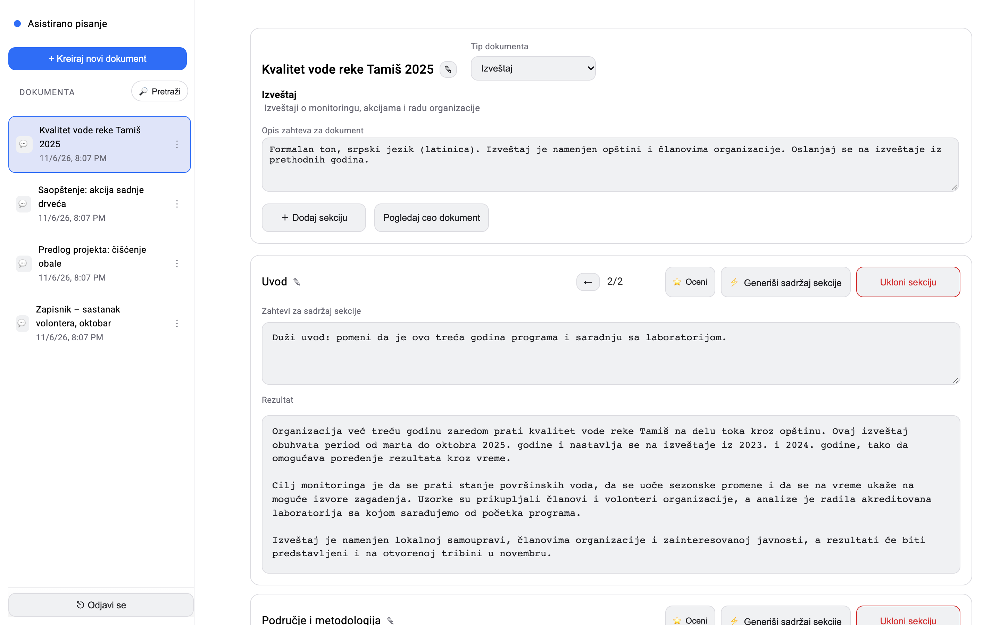
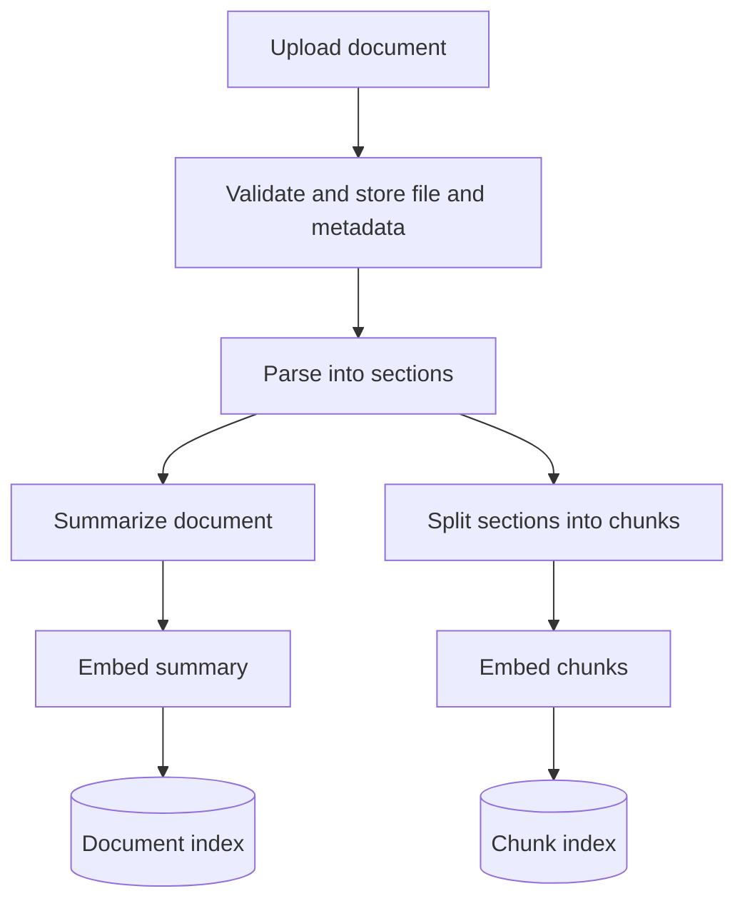
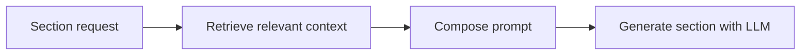

# AI-Assisted Document Drafting

## Academic context

Developed as a coursework project for "Information Systems Engineering", "Database Systems", and "Advanced Information Systems Architectures".

## Overview

This repository contains the document drafting subsystem of a larger information system, using an ecological organization as the case study. Implemented as a FastAPI microservice with an Angular frontend, the subsystem supports drafting documents from templates, user instructions, and an uploaded knowledge base. The rest of the information system is outside this repository's scope.

## Motivation

Documents of the same type share a structure and reuse information scattered across existing documents. Preparing a new draft requires finding and adapting that material.

## Goal

Reduce manual searching and repetitive writing when drafting template-based documents. Users generate, review, and revise individual sections using their instructions and an uploaded knowledge base.

Retrieval-augmented generation (RAG) retrieves relevant passages from that knowledge base and includes them in the prompt as source material for drafting each section.

## Features

- Document templates and section-based generation.
- Document upload and semantic search.
- Prompt versioning and test sessions.
- Generation history, feedback, and token and cost tracking.

## Document ingestion

Uploaded documents are parsed into sections. Document summaries and text chunks are embedded and indexed separately in Weaviate.

## Section generation

The global instruction retrieves documents by summary, filtered by document type. The section instruction retrieves chunks within those documents.

The prompt combines the template, section names, user instructions, and retrieved context. Each execution records the final prompt, prompt version, output, token usage, cost, and duration. Generation continues without retrieved context when no relevant documents are found.

## Future work

Further work is needed to validate generated claims against sources, cite supporting passages, and handle insufficient evidence. Retrieval should enforce document-level permissions, and uploaded content needs safeguards against prompt injection. Quality evaluation, regression tests, and retrieval tracing are needed to assess prompt and model changes. Usage limits, caching, and model routing could help control costs. Future integrations would also require user-scoped access and confirmation before sensitive actions.
